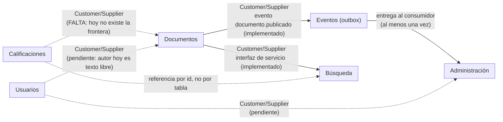

# Mapa de contextos delimitados

## Pregunta guía

**¿Qué palabra de nuestro dominio significa dos cosas según con quién hablemos?**

**Respuesta:** *"calificación"*. En `documentos` es un atributo que el documento trae desde que se
crea (hoy un dato semilla). En el lenguaje del proyecto, una calificación es el resultado de que un
estudiante puntúe un documento después de usarlo: tiene autor, fecha y se agrega en un promedio. Son
dos modelos distintos usando el mismo nombre, y hoy solo existe el primero. Se documenta como
violación V1 en [`auditoria-violaciones.md`](auditoria-violaciones.md).

## Contextos identificados

| Contexto | Lenguaje propio | Quién lo usa así | Implementación actual |
|---|---|---|---|
| **Usuarios** | "cuenta", "perfil", "rol", "credenciales" | Estudiante que se registra o inicia sesión | Solo `/ping`; sin tablas |
| **Documentos** | "documento" = material académico con metadatos y autor | Quien publica o clasifica material | Firestore, `repository.py`, publicación idempotente |
| **Búsqueda** | "documento" = resultado: proyección liviana ordenada por calificación | Estudiante que busca y filtra | `busqueda.service` sobre `documentos.service` |
| **Calificaciones** | "calificación" = valoración puntual de un estudiante, con autor y fecha | Estudiante que evalúa lo que usó | Solo `/ping`; el valor vive en `documentos` (V1) |
| **Administración** | "usuario"/"documento" = objeto de moderación | Administrador | Métricas, bandeja de revisión y resolución |

**Documentos** y **Búsqueda** ya usan "documento" con significados distintos (activo completo vs.
proyección de solo lectura) y está bien resuelto: no comparten almacenamiento y `busqueda.service`
consume a `documentos.service` por interfaz. Es el patrón que debería aplicarse a "calificación".

## Relaciones entre contextos

| Relación | Tipo | Estado |
|---|---|---|
| Documentos → Búsqueda | Customer/Supplier | Implementado por `busqueda.service` → `documentos.service` |
| Documentos → Eventos → Administración | Customer/Supplier + evento | Implementado: outbox, deduplicación y bandeja |
| Calificaciones → Documentos | Customer/Supplier | **No implementado**; `calificacion` vive en `documentos` (V1) |
| Usuarios → Documentos | Customer/Supplier | **No implementado**; `documentos.autor` es texto libre (V2) |
| Usuarios → Administración | Customer/Supplier | Pendiente: la bandeja usa el nombre del payload, no una cuenta |
| Almacenamiento de archivos / Correo (externos) | Candidatos a capa anticorrupción | No implementados; al integrarlos deben aislarse tras un adaptador |

No se adopta *shared kernel*: la regla del ADR 0001 («un módulo no accede a las tablas internas de
otro») es, en vocabulario DDD, **un solo escritor por dato**.

## Trazabilidad

- Regla base: [`../adr/0001-estilo-arquitectonico.md`](../adr/0001-estilo-arquitectonico.md)
- Propiedad de datos: [`propiedad-datos.md`](propiedad-datos.md)
- Violaciones y plan: [`auditoria-violaciones.md`](auditoria-violaciones.md)
- Cambio de frontera propuesto: [`../adr/0003-separacion-contexto-calificaciones.md`](../adr/0003-separacion-contexto-calificaciones.md)
- Evento: [`../eventos/contrato-evento.md`](../eventos/contrato-evento.md)
